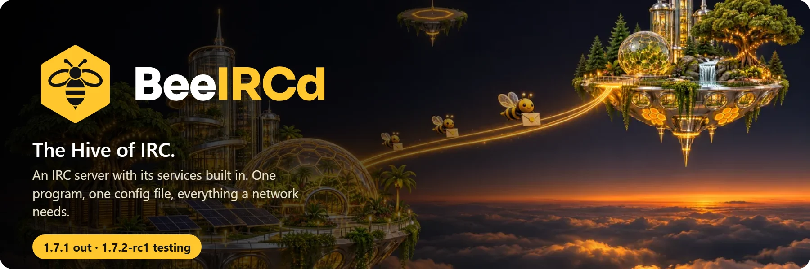
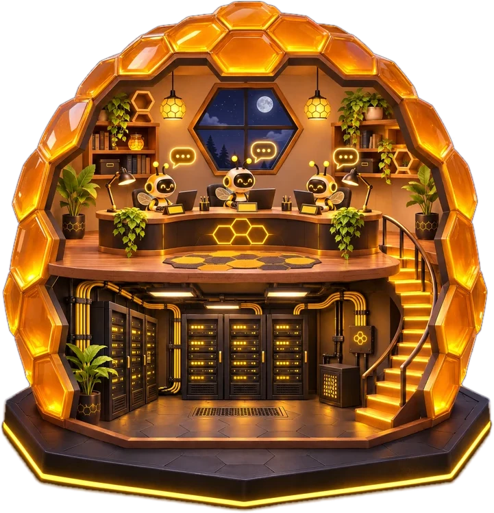
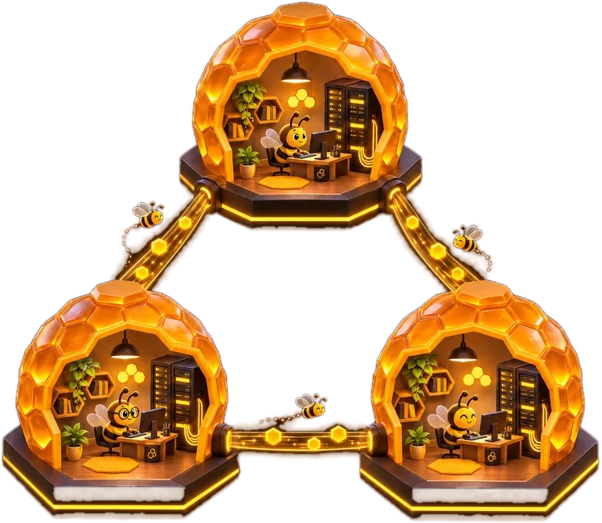
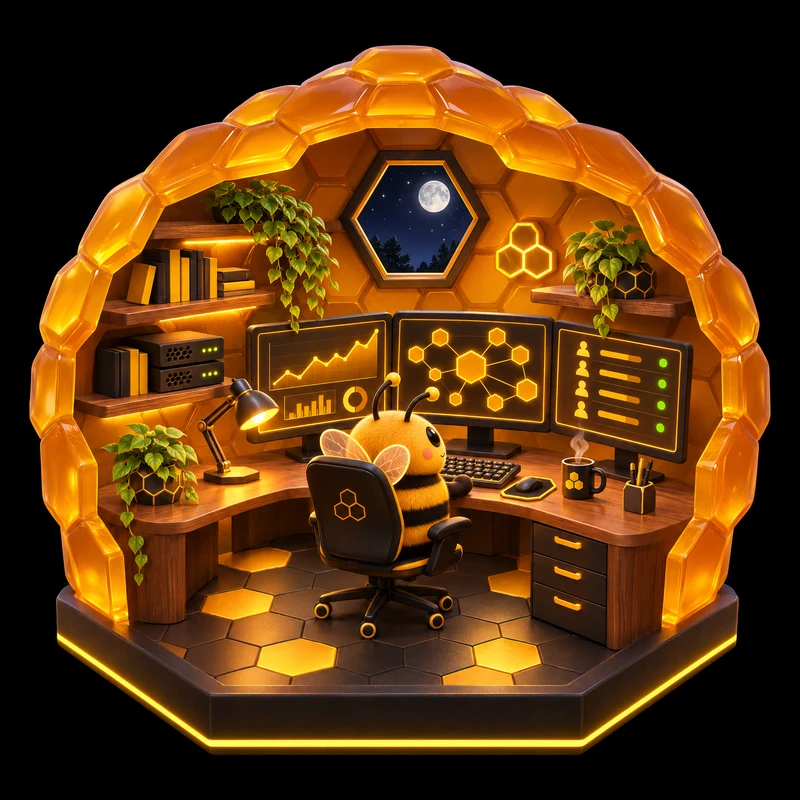
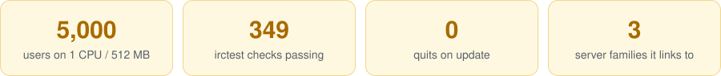

<div align="center">



[](https://github.com/fhazal/BeeIRCd/actions/workflows/ci.yml)

[](LICENSE)
[](https://github.com/fhazal/BeeIRCd/releases/latest)
[](https://github.com/fhazal/BeeIRCd/releases)


**[Install](docs/INSTALL.md)** · **[Run it](docs/ADMIN.md)** · **[Features](docs/FEATURES.md)** · **[What's new](https://github.com/fhazal/BeeIRCd/releases/latest)** · **[Website](https://beeircd.org)** · **[Try the web chat](https://chat.beeircd.org/)**

</div>

> [!NOTE]
> **1.7.1 is out** with 60 linking and security fixes. **1.7.2-rc1** is testing now on our own network: SASL over links to UnrealIRCd and InspIRCd, and a new `sasl_server` setting.

## 🐝 Why BeeIRCd

Running an IRC network usually means two programs wired together: a server (UnrealIRCd, InspIRCd) and a services package (Anope, Atheme). BeeIRCd is both, written from scratch in Go by **BajuBesi Labs**.

<table>
<tr>
<td width="50%" align="center"></td>
<td width="50%">

### 🧩 All in one
**One building, every floor already furnished.**

- Server and services in a single program
- NickServ, ChanServ, MemoServ and friends from the first start
- One database, one config file

</td>
</tr>
<tr>
<td width="50%">

### 🔗 Grows into a network
**Start with one server, add more when you need them.**

- TLS links locked by pinned keys, no passwords
- Links to BeeIRCd, UnrealIRCd 6 and InspIRCd 4
- Connect classes and link rules included

</td>
<td width="50%" align="center"></td>
</tr>
<tr>
<td width="50%" align="center"></td>
<td width="50%">

### 🔄 Updates without goodbyes
**The hive moves house and nobody notices.**

- `beeircd update` hands every connection to the new version
- Nicks, channels, logins and history stay
- Nobody sees a quit

</td>
</tr>
<tr>
<td width="50%">

### 🍯 Hive Panel
**A web control room, built in.**

- Opers sign in with their oper account
- Each sees only what their flags allow
- Every change kept in history, with undo

</td>
<td width="50%" align="center"></td>
</tr>
</table>

<picture>
  <source media="(prefers-color-scheme: dark)" srcset="docs/readme/stats-dark.svg">
  
</picture>

## ✨ What's inside

<table>
<tr><td width="50%" valign="top">

**🖧 Server**<br>
TLS, cloaking, Unreal-style modes, extbans, spam filter, connect classes, `STATS Y/G`, English + Malay

</td><td width="50%" valign="top">

**🤖 Services (Anope 2.0)**<br>
NickServ, ChanServ, MemoServ, HostServ, OperServ, BotServ, AdminServ, Global, `import-anope`

</td></tr>
<tr><td valign="top">

**📡 IRCv3**<br>
CAP 302, SASL, message-tags, labeled-response, metadata, channel rename, MONITOR, WHOX

</td><td valign="top">

**✅ Tested**<br>
Unit, fuzz and race tests, 6 h soak, link tests against UnrealIRCd 6 and InspIRCd 4 before every release

</td></tr>
</table>

The full list, with what is planned and what is only an idea, is in [docs/FEATURES.md](docs/FEATURES.md).

## 🗺️ Roadmap

| Version | What | Status |
| --- | --- | --- |
| **1.0 – 1.4** | Server, services, linking, Hive Panel, BeeRoom, spam filter, Anope import, languages, seamless updates | ✅ Released |
| **1.5** | IRCv3 metadata, channel rename | ✅ Released |
| **1.6** | Channel stats, help channel, accounts per email | ✅ Released |
| **1.7** | Connect classes, link rules, `STATS Y/G` | ✅ Released |
| **1.7.1** | 60 linking and security fixes | ✅ Released |
| **1.7.2** | SASL over links, `sasl_server` | ✅ Released |
| **1.7.3** | Last small UnrealIRCd / InspIRCd features (+c, hidden lists and modes, oper log, security group rules) | 🔨 Building |
| **Later** | Module system | 🔭 Planned |

## 📦 Installing

```sh
curl -fsSL https://beeircd.org/install.sh | sudo sh
```

Nine questions, then it runs. [docs/INSTALL.md](docs/INSTALL.md) has the details
(firewall, certificates, proxies); [docs/ADMIN.md](docs/ADMIN.md) covers running it
(`beeircd status`, AdminServ, the Hive Panel, linking servers, backups,
updates, every setting).

## 🛠️ Building

Needs Go 1.27 or newer.

```sh
go build ./cmd/beeircd
./beeircd version
```

Checks (gofmt, `go vet`, [staticcheck](https://staticcheck.dev) and every test):

```sh
scripts/check.sh
```

## 📂 Layout

| Folder | What lives there |
| --- | --- |
| `cmd/beeircd` | the `beeircd` program and its commands |
| `docs/` | installing, running and the feature list |
| `internal/` | the server, services and storage, one package each |
| `tools/` | live checks, load generator, irctest controller |
| `scripts/` | developer scripts |


## 📜 Licence

<table><tr><td valign="top" width="50%">

**✅ You can**
- Run it for any network, big or small, free or paid
- Change it, fork it and share it
- Use it at work or in a business

</td><td valign="top" width="50%">

**📋 When you do**
- Keep the licence and copyright notices
- Share your changes if you run a changed BeeIRCd for other people (that is the "Affero" part)
- Give your changes the same licence

</td></tr></table>

BeeIRCd is free software under the [GNU Affero General Public License v3.0 or later](LICENSE). It comes with no warranty.

---

<div align="center">

<picture>
  <source media="(prefers-color-scheme: dark)" srcset="docs/logo/logo-dark.svg">
  
</picture>

**The Hive of IRC**

[Website](https://beeircd.org) · [Install](docs/INSTALL.md) · [Releases](https://github.com/fhazal/BeeIRCd/releases) · [Report a bug](https://github.com/fhazal/BeeIRCd/issues)

<sub>Made with ☕ by <b>BajuBesi Labs</b> · © 2026</sub>

</div>
